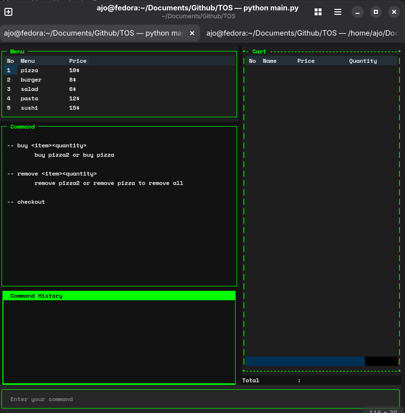

# TOS (Terminal Order System)

A terminal-based food ordering application built with Python and Textual.

I this project i leanr about tui. And thats amazing

## Description

**TOS (Terminal Order System)** is a terminal-based food ordering application that allows users to order food directly through the command line. Although it is a dummy application with no real-world ordering or payment functionality, it simulates a simple food ordering experience.

Built with Python and [Textual](https://github.com/Textualize/textual), TOS runs entirely in the terminal and provides an interactive interface featuring a food menu, a live shopping cart, and a command prompt, all displayed on a single screen.

Users can enter short commands to add or remove items from their cart. The cart table and total price update instantly whenever changes are made. A command history panel keeps track of previously entered commands, while invalid commands are highlighted in red.

When users are ready to check out, they can use the checkout command to open a confirmation dialog displaying their order summary and total price. Confirming the order places it and clears the shopping cart, while going back leaves the cart unchanged.

### Screenshots



## Getting Started

### Dependencies

Before running the application, make sure you have the following installed:

- Python 3.8 or later
- pip (Python package installer)

### Installing

You can install TOS directly from GitHub using pip.

1. Open your terminal.
2. Run the following command:

   ```bash
   pip install git+https://github.com/Ajo-Subarjo/TOS && tos
   ```

### Executing Program

After installing TOS, you can launch the application by running:

   ```bash
   tos
   ```

The application will start directly in your terminal.

## Help

If you encounter any problems while running TOS, try the following:

- Make sure Python and pip are properly installed.
- Ensure you have an active internet connection during installation.
- Try reinstalling the package if the command is not recognized.

To reinstall the application:

   ```bash
   pip uninstall tos
   pip install git+https://github.com/Ajo-Subarjo/TOS
   ```

### Removing the Program

To uninstall TOS from your machine, run:

   ```bash
   pip uninstall tos
   ```

## License

This project is licensed under the MIT License. See the [LICENSE.md](LICENSE.md) file for details.